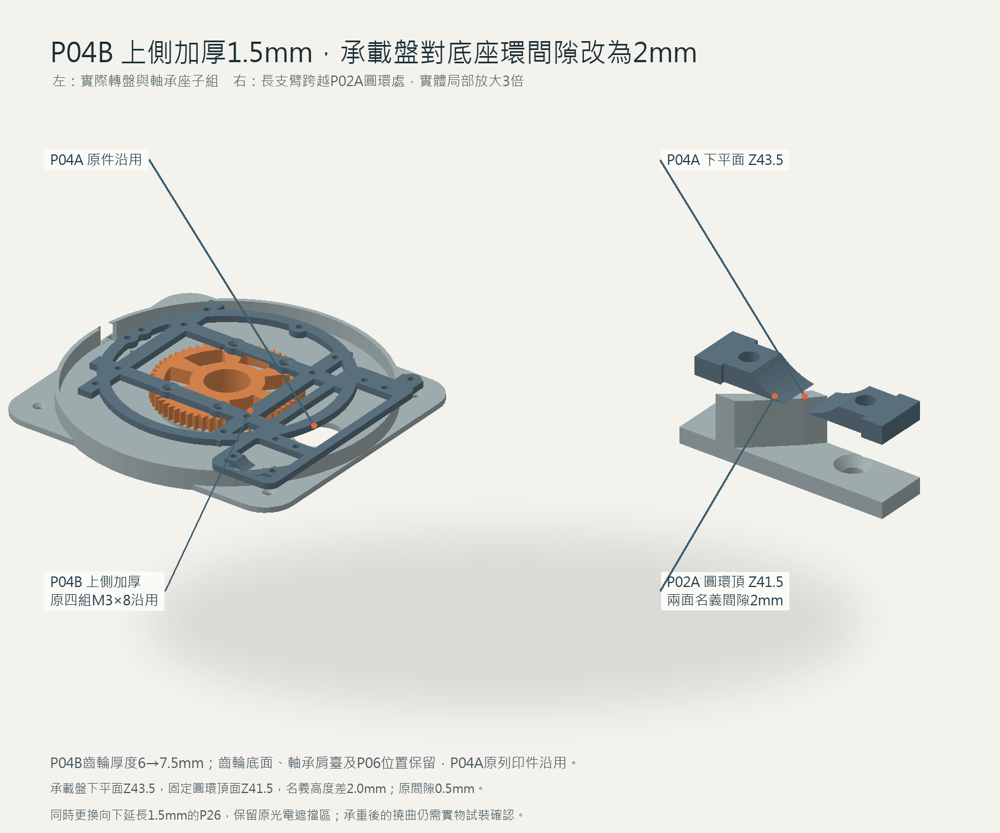

# ESP32-C3 撲克牌發牌機

以 ESP32-C3 SuperMini、28BYJ-48 步進馬達、直流馬達及 3D 列印零件製作的充電式旋轉發牌機。目前版本為 **V1.0.0**。

## 下載與組裝

- **[線上 3D 組裝說明書](https://shihkefa.github.io/esp32c3-card-dealer/)**：直接用電腦或手機開啟，可旋轉、縮放及分解模型，不必先下載。
- [完整專案 ZIP](發牌機_完整專案_V1.0.0.zip)：包含模型、BOM、接線圖、韌體及離線組裝手冊。
- [版本說明與使用入口](V1.0.0/README_先讀這個.txt)
- [Excel BOM](V1.0.0/發牌機_BOM_V1.0.0.xlsx)
- [40 種獨立列印零件](V1.0.0/3d/STL/)
- [整機組裝 STL](V1.0.0/發牌機_整機組裝_V1.0.0.stl)：供檢視組裝位置，請使用獨立零件列印。
- [可修改的 CAD 來源](V1.0.0/3d/source/)
- [韌體來源與燒錄說明](V1.0.0/firmware/)
- [完整接線圖與板型參考](V1.0.0/wiring/)

線上版與離線版使用同一份完整手冊，含 22 個步驟、可旋轉及縮放的 3D 模型、零件與螺絲選取，以及互動接線圖。需要離線使用時，下載並解壓 ZIP，再用瀏覽器開啟 `V1.0.0/manual/發牌機_組裝說明書_V1.0.0.html`。

## 目前設計

- 每局將出牌口朝向第一位玩家；三人逐張轉 120°，四人逐張轉 90°。
- 設定每人張數、玩家人數及餘牌張數；餘牌發往第一、第二位玩家中間。
- 牌倉內寬 61 mm、前後開放，參考牌型 57×87 mm 與 60×96 mm；牌路向出牌口下傾 6°，靠重力落牌。
- OLED 與四個按鍵位於上殼頂部；韌體預設關閉 Wi-Fi 與 BLE。
- 使用單顆 18650、Type-C 充電；依本版接線說明關機充電。
- 列印件以拓竹 A1 mini 的尺寸範圍設計；螺絲採 M3×8 與 M3×25 內六角沉頭兩種規格。

## 最新機構修訂

P04B 齒輪厚度由 6 mm 增至 **7.5 mm**，上部抬高 **1.5 mm**，將 P04A 與 P02A 頂圈的名義間隙由 0.5 mm 增至 **2 mm**。P26 遮光片同步向下延長 1.5 mm，以保留原感測區。

此修訂只需重印 **P04B、P26**，其他 38 種 STL 沿用，包含 P04A 及目前 A 包覆 B 的上殼。

## 驗證與限制

本版已完成模型干涉、離散旋轉及裝入路徑、螺絲螺母配合、STL 完整性和離線手冊的檢查，紀錄位於 [verification](V1.0.0/verification/) 及 [3d](V1.0.0/3d/)。這些是名義模型驗證；載重撓曲、實印公差、實際模組尺寸、耗電及發牌速度仍需試裝與實測。現有 28BYJ-48 與外部 2:1 減速配置不能保證逐張轉向時每秒 2～4 張。

[SHA-256 檔案校驗表](V1.0.0/SHA256SUMS.txt) 對應版本資料夾內的交付檔；本儲存庫保留原始位元組，避免換行轉換影響校驗。

第三方元件、文件與程式庫保留其原有來源及授權說明。

## 更新線上手冊

重新建立版本資料夾中的手冊後，執行 `python scripts/update_pages.py --version V1.0.0`，再將更新後的 `docs/` 提交並推送到 `main`。GitHub Pages 從 `main` 的 `/docs` 發布，入口為 `docs/index.html`；`.nojekyll` 保留原始 HTML，Three.js 授權另置於同目錄。
